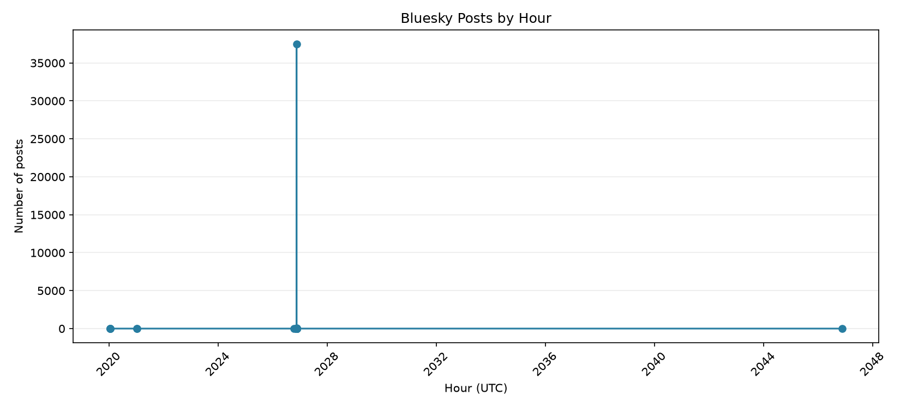
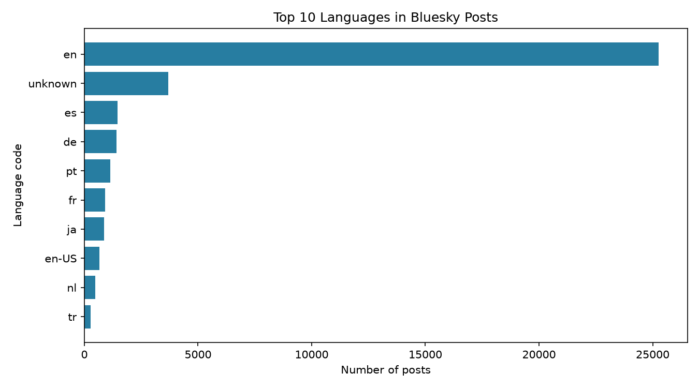

# Bluesky Jetstream: A Real-Time Social Media Data Pipeline

**Author:** Yannely Escalante Ruiz  
**DS 3022 Data Project 3, Fall 2026**

## Data source

For this project, I used Bluesky Jetstream, a live WebSocket stream of activity from the Bluesky social media platform.

The stream URL is:

`wss://jetstream2.us-east.bsky.network/subscribe`

Bluesky Jetstream is a push-based source, meaning that messages arrive continuously over the WebSocket connection instead of my program repeatedly requesting data. The stream includes events such as creating, updating, and deleting records. Each event contains information such as the user's decentralized identifier (DID), event type, timestamp, and commit details. For posts, it can also include the record key, collection, text, language information, and whether the post is a reply.

The stream did not require an API key or account for my project. During my source probe, I received 2,934 messages in 60 seconds, or approximately 48.87 messages per second, with no invalid JSON messages.

My research question was: **How does posting activity on Bluesky vary by hour, and which languages appear most frequently in the observed posts?**

## How to run

The project requires Python, Docker, and the Python dependencies used by the producer, lander, and Prefect flow. The following commands should be run from the repository root unless otherwise indicated.

1. Clone the repository and enter the project directory.

   ```bash
   git clone https://github.com/yannelye/ds3022-streaming.git
   cd ds3022-streaming
   ```

2. Create and activate a virtual environment, then install the dependencies.

   ```bash
   python3 -m venv .venv
   source .venv/bin/activate
   pip install -r requirements.txt
   ```

3. Start the Redpanda Kafka cluster using the repository's Docker Compose configuration.

   ```bash
   docker compose up -d
   ```

4. Create the Bluesky Kafka topic with three partitions and replication factor three.

   ```bash
   docker exec -it redpanda-0 rpk topic create bluesky -p 3 -r 3
   ```

   If the topic already exists, it does not need to be created again.

5. Enter the Project3 directory.

   ```bash
   cd Project3
   ```

6. Start the producer in one terminal.

   ```bash
   python producer.py
   ```

   This connects to Bluesky Jetstream and publishes events to Kafka.

7. Start the lander in another terminal.

   ```bash
   python lander.py
   ```

   This consumes Kafka messages and saves batches as Parquet files in `data/raw/`.

8. Start the Prefect server in a separate terminal.

   ```bash
   prefect server start
   ```

   In the terminal used to run the flow, configure the Prefect API URL:

   ```bash
   export PREFECT_API_URL=http://127.0.0.1:4200/api
   ```

9. Run the full pipeline after raw files have been collected.

   ```bash
   python flow.py
   ```

   The flow builds DuckDB tables, calculates summary statistics, and generates charts.

10. Run the committed sample independently of Kafka.

   ```bash
   python flow.py data/sample
   ```

   The sample contains 5,000 records and allows another student to test the pipeline without collecting live data.

The Prefect dashboard is available at `http://127.0.0.1:4200`, and the Redpanda Console is available at `http://127.0.0.1:8080`.

## Architecture

```text
Bluesky Jetstream WebSocket
            |
            v
       producer.py
            |
            v
    Kafka topic: bluesky
    3 partitions, RF = 3
            |
            v
        lander.py
            |
            v
    data/raw/*.parquet
            |
            v
         flow.py
            |
            v
       Prefect tasks
    load_raw -> stage
          -> entities
          -> marts
          -> charts
            |
            v
      DuckDB database
       bluesky.duckdb
            |
            v
  charts/bluesky_posts_per_hour.png
  charts/bluesky_languages.png
```

The producer receives live events and sends them to the `bluesky` Kafka topic. The lander consumes those messages, preserves Kafka metadata, and writes raw records into Parquet files. The Prefect flow loads the raw data into DuckDB, removes repeated Kafka records, identifies Bluesky posts, builds hourly and language summaries, and generates visualizations.

The pipeline also supports a smaller sample dataset, which runs through the same processing tasks without needing a running producer or Kafka consumer.

## Design decisions

1. **Key and partitions.** I used the Bluesky DID as my Kafka message key because it identifies the account associated with each event. My Kafka topic has three partitions and a replication factor of three. Using the DID as the key keeps events from the same account in the same partition, preserving their order within that partition. A random key could distribute events from the same account across different partitions and make their ordering harder to interpret.

2. **Batch size and time.** My lander writes a Parquet file after collecting 1,000 records or reaching 60 seconds, whichever happens first. My source probe measured approximately 48.87 messages per second, so under normal conditions a batch can fill in about 20 seconds. This means the 1,000-record limit usually closes batches before the time limit, producing roughly 176 files per hour at the probed rate. The 60-second limit is still important when the stream slows down.

3. **Offsets after the file.** I designed the lander to save a Parquet file before storing the corresponding Kafka offsets. If the program crashes after the file is written but before the offsets are stored, it may consume and land some of the same messages again when restarted. I accept this at-least-once behavior because keeping an extra copy is safer than losing records. In my D1 experiment, the raw data contained 1,546 more rows than the unique Kafka record count after recovery.

4. **Duplicates.** Two rows represent the same Kafka record when they have the same Kafka partition and offset. My staging step uses `ROW_NUMBER()` to keep one row for each partition-and-offset combination. A different kind of duplicate occurs when the same Bluesky post appears in multiple events, such as an update or repeated delivery. The entity step identifies posts using the DID and record key (`rkey`) and keeps the latest observed version. These two steps prevent duplicate Kafka deliveries and repeated post identities from being counted the same way.

5. **Windows and time.** My posting activity analysis uses the event timestamp from the Bluesky data rather than the time the lander saved the message. I group activity into one-hour windows because I wanted to compare how posting activity changes throughout the day. Event time is more appropriate for this question because a message might be landed later than when the original activity occurred.

6. **Ten times the volume.** At ten times my measured rate, the stream would produce approximately 489 messages per second. The lander would need to write Parquet files much more frequently, and repeatedly loading all raw files into DuckDB could become slower. I would consider larger batches, multiple consumers, partitioned storage, and incremental processing instead of rebuilding everything from all historical files. I would also monitor Kafka consumer lag and disk usage.

## Chaos round

| Card | Prediction | What I did | Numbers before → after | Explanation |
|---|---|---|---|---|
| D1 Crash between file and offsets | The lander would save a file and crash before storing offsets. Restarting it could create duplicate raw records, but the staging step would deduplicate them. | Ran `python lander.py crash`, confirmed the intentional crash after a 1,000-record file, restarted the lander, collected additional messages, and reran the flow. | Raw: 274,000 → 333,799; malformed: 0 → 0; unique Kafka: 274,000 → 332,253; unique posts: 29,426 → 36,252. | The raw dataset ended with 1,546 more records than the unique Kafka count. This demonstrates why at-least-once processing can produce repeated records and why deduplication makes the flow safe to rerun. New messages were also collected during the experiment, so not all increases were caused by replay. |
| D2 Poison message | The lander would preserve the invalid message as malformed without crashing or creating a Bluesky post. | Used `docker exec -it redpanda-0 rpk topic produce bluesky -k bad` and sent `this is not JSON`. Restarted the lander, observed a one-record Parquet file, and reran the flow. | Raw: 333,799 → 333,800; malformed: 0 → 1; unique Kafka: 332,253 → 332,254; unique posts: 36,252 → 36,252. | The lander continued operating and kept the invalid message in raw storage. The malformed count increased, but the unique post count stayed the same. My flow includes malformed messages in the unique Kafka count because they still have a valid Kafka partition and offset. |
| D4 Source drops | Interrupting the live producer would stop new messages temporarily, but restarting it would allow collection to continue. | Ran the producer, stopped it using Ctrl+C, waited, restarted it, confirmed a new Bluesky Jetstream connection, landed the new Kafka messages, and reran the flow. | Raw: 333,800 → 361,800; malformed: 1 → 1; unique Kafka: 332,254 → 360,254; unique posts: 36,252 → 39,234. | The producer successfully reconnected after a manual interruption, and the lander subsequently processed 28,000 additional Kafka records. Because Jetstream is a push-based live stream and I did not replay a historical cursor, some events from the disconnected period may have been missed. |

## The four numbers

The following results come from the completed Prefect flows. The full dataset reflects the final run after the chaos experiments.

| Number | Full data | Sample (`data/sample`) |
|---|---:|---:|
| Raw records landed | 361,800 | 5,000 |
| Malformed (kept in raw) | 1 | 0 |
| Unique Kafka records | 360,254 | 5,000 |
| Unique Bluesky posts | 39,234 | 557 |

The full-data flow also generated 34 hourly windows and identified 71 languages. The sample flow generated 6 hourly windows and identified 25 languages.

## Challenges / Obstacles

One challenge was working with a live WebSocket source because messages arrive continuously and the connection can occasionally close. I added reconnect behavior to the producer so it could continue collecting messages after a disconnection.

Another challenge was coordinating several parts of the pipeline at once. I needed Docker and Redpanda running while using separate terminals for the producer, lander, and Prefect server. I also had to make sure the lander wrote files correctly before running the analysis.

I used Python, Kafka-compatible Redpanda, Quix Streams, Parquet, DuckDB, Prefect, and Matplotlib to build and test the pipeline. The chaos experiments were especially useful because they showed why saving raw data, tracking offsets, and deduplicating records are important.

## Analysis

My research question was how Bluesky posting activity changes by hour and which languages appear most frequently in the observed posts. The completed pipeline processed 361,800 raw records and identified 39,234 unique Bluesky posts, with activity represented across 34 hourly windows and 71 language categories. One interesting finding was that the number of raw stream events was much larger than the number of unique posts. This is because the stream contains different types of events, and some events refer to the same underlying record. The hourly and language charts help summarize posting activity after processing the stream. One limitation is that my dataset is a relatively short live observation rather than a representative sample of all Bluesky activity. Events missed during a disconnected period might also affect the results, so I cannot use this dataset alone to make broad conclusions about long-term posting patterns.

## Plot / Visualization

I created two visualizations using Matplotlib.

The first chart shows Bluesky post activity grouped into hourly windows, using event time. It helps compare posting volume across the hours represented in the collected dataset.



The second chart summarizes the languages identified in the observed Bluesky posts.



The sample pipeline also produces versions of these charts in `charts/sample/`.

## Reflection

Before this project, I understood the basic idea of moving data from one place to another, but I did not fully understand how much can go wrong when data arrives continuously. Working with Bluesky Jetstream helped me see how a producer, Kafka topic, consumer, Parquet storage, and analysis flow work together. I learned that saving data successfully does not automatically mean a message will never appear again. The intentional crash showed me why offset handling and deduplication matter. I also learned that malformed messages should not necessarily stop the entire pipeline, because preserving the raw record makes it possible to investigate the problem later. One of the hardest parts was keeping track of multiple terminals and making sure each service was running correctly. If I started again, I would organize my testing and documentation earlier, especially the screenshots and before-and-after numbers. Overall, this project helped me understand streaming systems through actual experiments instead of only reading about them.

## Acknowledgements

I used the original class earthquake producer, lander, and flow scripts as starting points and adapted them for Bluesky Jetstream. I also used the course's Project 3 instructions, checkpoint requirements, and chaos cards to guide the implementation and testing.

I used ChatGPT to help explain Kafka and Prefect concepts, troubleshoot terminal commands, adapt and review Python code, organize the chaos experiments, and draft documentation. I checked the suggested commands against my terminal output and used the actual results from completed Prefect runs rather than invented numbers. I also used the Bluesky Jetstream service as the external data source.